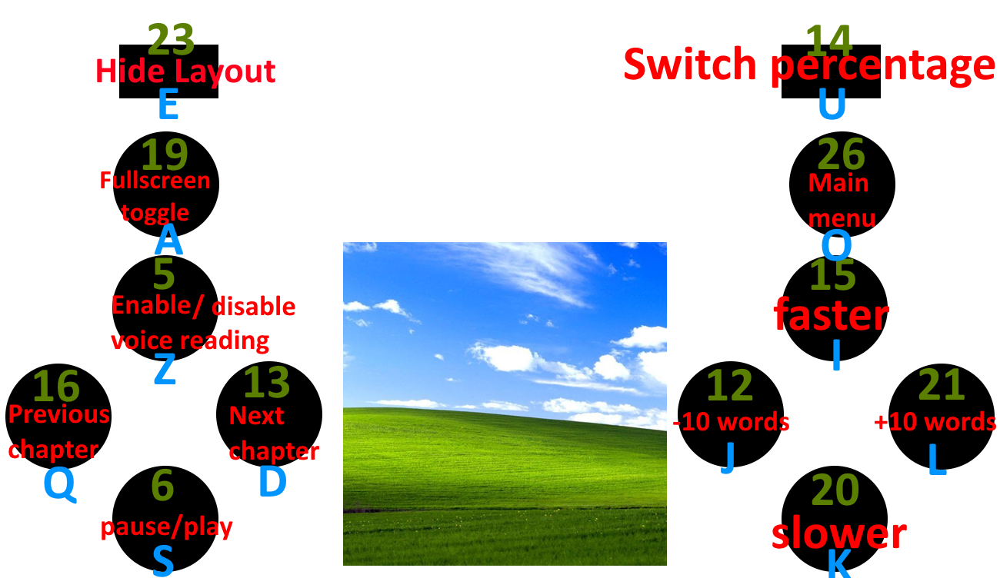

# book-reader-pi13

A word-by-word EPUB reader for a Raspberry Pi with a 240×240 screen and 10 physical buttons.

Books are shown one word at a time in the middle of the screen (RSVP-style speed reading). How long each word stays depends on its length and punctuation, and you can make the reading faster or slower, pause it, skip ahead or go back. Each book remembers where you stopped.



## Features

- Reads `.epub` files straight from the `books/` folder. No conversion needed.
- Word-by-word display with a delay that adapts to each word:
  - longer words stay on screen longer
  - words ending with `.` stay 2× longer, words ending with `,` stay 1.5× longer
- Adjustable speed in 10% steps, pause/play, jump ±10 words, previous/next chapter.
- Progress saved per book (chapter and word) in `book_progression.pkl`.
- Menus driven only by the physical buttons: main menu, books list (scrolling), options.
- Three themes: dark, light and matrix (green text on black), chosen in **Options** and remembered in `settings.pkl` (dark on first launch).
- "Exit to Debian" and "Shutdown Pi" from the main menu.
- Runs on Windows for development, with the keyboard standing in for the GPIO buttons.

## Requirements

- Python 3.9+ with tkinter
- On Windows (development): `pip install keyboard`
- On Raspberry Pi (Linux): `gpiozero` (preinstalled on Raspberry Pi OS, otherwise `pip install gpiozero`)

## Usage

1. Put your `.epub` files in the `books/` folder next to `run_ui.py`.
2. Start the reader:

   ```bash
   python run_ui.py
   ```

3. Open **Books list**, pick a book, and reading starts where you last stopped.

The script detects the platform on its own: on Windows it listens to the keyboard, on Linux it listens to the GPIO buttons.

## Controls

Each button is wired between its GPIO pin and ground; the internal pull-up is enabled. The key in the third column does the same thing as the button when running on Windows.

| Button      | GPIO | Key | While reading                  | In menus              |
|-------------|------|-----|--------------------------------|-----------------------|
| Top left    | 19   | A   | Toggle fullscreen              | Toggle fullscreen     |
| Left top    | 5    | Z   | *(reserved: voice reading)*    | —                     |
| Left left   | 16   | Q   | Previous chapter               | —                     |
| Left right  | 13   | D   | Next chapter                   | —                     |
| Left down   | 6    | S   | Pause / play                   | —                     |
| Top right   | 26   | O   | Save progress, back to books   | Back to main menu     |
| Right top   | 15   | I   | Faster (−10% delay)            | Move selection up     |
| Right left  | 12   | J   | Go back 10 words               | —                     |
| Right right | 21   | L   | Skip 10 words                  | Validate selection    |
| Right down  | 20   | K   | Slower (+10% delay)            | Move selection down   |

> Progress is saved when you leave a book with the top right button. Closing the program in any other way while reading loses the progress made in that session.

## Reader screen

```
┌───────────────────────────────┐
│ Page progression   Book prog. │
│ 120 / 2040 words     3 / 27   │
│                               │
│            current            │
│                               │
│ Battery            Delay      │
│ 42 %               100%       │
└───────────────────────────────┘
```

"Pages" are the chapters of the EPUB (one per entry of the EPUB spine). The battery value is a placeholder for now.

## Configuration

All settings are in the `CONFIGURATION` dictionary at the top of `run_ui.py`:

| Key                      | Default      | Purpose                                                   |
|--------------------------|--------------|-----------------------------------------------------------|
| `IS_FULLSCREEN_AT_START` | `False`      | Start in fullscreen                                       |
| `RESOLUTION`             | `"240x240"`  | Window size                                               |
| `BOOKS_FOLDER`           | `./books`    | Where the EPUB files are                                  |
| `BOOKS_VISIBLE_AT_ONCE`  | `5`          | Number of books shown at once in the list                 |
| `BOOK_NAME_MAX_LENGTH`   | `24`         | Longer titles are cut with `...`                          |
| `BOOK_PROGRESSION_FILE`  | `./book_progression.pkl` | Saved progress of every book                  |
| `SETTINGS_FILE`          | `./settings.pkl`         | Saved user settings (theme)                   |
| `GENERAL_DELAY`          | `0.15`       | Base delay (seconds) at 100% for a reference-size word    |
| `STEP_PERCENTAGE`        | `10`         | Speed change per button press                             |
| `WORD_SIZE_REFERENCE`    | `5`          | Word length that gets exactly the base delay              |
| `OFFSET_DELAY_MS`        | `0.15`       | Constant delay (seconds) added to every word              |
| `DOT_DELAY`              | `2.0`        | Multiplier for words ending with `.`                      |
| `COMMA_DELAY`            | `1.5`        | Multiplier for words ending with `,`                      |
| `JUMP_WORDS_QTY`         | `10`         | Words skipped by the jump buttons                         |
| `WORD_FONT_SIZE`         | `20`         | Font size of the current word                             |
| `INFO_FONT_SIZE`         | `7`          | Font size of the corner info                              |

Display time of a word:

```
delay = OFFSET_DELAY_MS + punctuation × (len(word) / WORD_SIZE_REFERENCE) × GENERAL_DELAY × (speed% / 100)
```

Colors for the three themes are in the `THEMES` dictionary. Each entry added there also appears in the options menu.

## Raspberry Pi notes

- "Shutdown Pi" runs `sudo shutdown -h now`, so the user running the script needs passwordless sudo (the default `pi` user has it).
- To start the reader at boot, launch `python /path/to/run_ui.py` from the desktop autostart of your Pi.

## Project structure

```
book-reader-pi13/
├── run_ui.py               # the whole application
├── books/                  # your .epub files
├── book_progression.pkl    # saved progress (created automatically)
├── settings.pkl           # saved settings (created automatically)
└── layout.png              # button layout
```

## Roadmap

- Voice reading through a speaker (left top button)
- Real battery level
- Go to the next chapter automatically at the end of a chapter
- Save progress on exit and shutdown, not only when leaving a book
